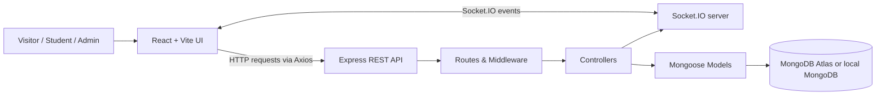
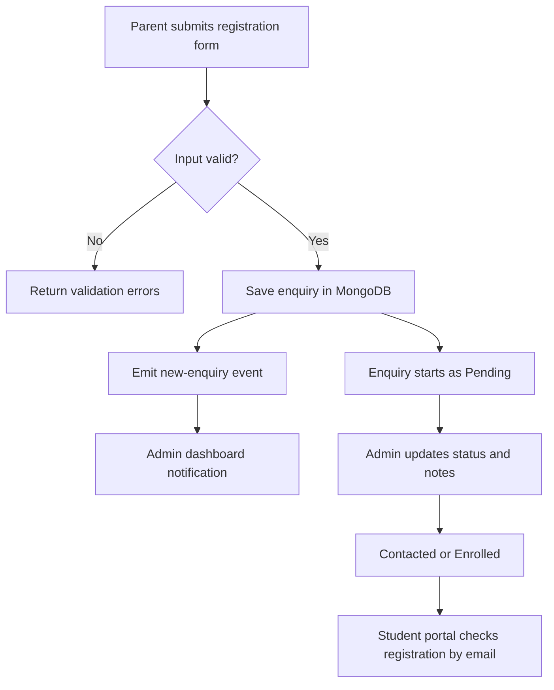

<div align="center">

# 🎓 Workshop Management System

### AI & Robotics Summer Workshop · Registration, Enquiries & Student Portal

A full-stack web application for promoting a workshop, collecting student registration enquiries, and managing follow-ups through a live admin dashboard.

[](https://react.dev/)
[](https://vite.dev/)
[](https://tailwindcss.com/)
[](https://nodejs.org/)
[](https://expressjs.com/)
[](https://www.mongodb.com/)
[](https://socket.io/)

</div>

---

## ✨ Overview

Workshop organisers often manage registrations through messages, phone calls, and spreadsheets. This project brings the main workflow into one place: visitors explore the AI & Robotics workshop, parents or guardians submit an enquiry, students can create an account, and administrators manage registrations from a protected dashboard.

The application uses a **React + Vite frontend**, a **Node.js + Express REST API**, **MongoDB with Mongoose**, JWT-based authentication, bcrypt password hashing, and Socket.IO events for new-enquiry notifications.

> **Project status:** Local development project. The supplied project report describes browser-tested registration and admin workflows. Deployment, payment processing, and automated email/SMS are not included.

## 🚀 Highlights

- **Workshop landing page** — hero section, workshop details, features, learning outcomes, curriculum, testimonials, FAQs, and registration form.
- **Registration enquiry flow** — captures parent/guardian name, email, and Indian mobile number with client-side and server-side validation.
- **Student accounts** — sign-up, login, and a personal portal showing the registration status when an enquiry matches the account email.
- **Admin dashboard** — summary counts, enquiry table, search, status filtering, pagination, status updates, admin notes, and deletion.
- **Real-time alerts** — server emits a `new-enquiry` Socket.IO event after an enquiry is saved.
- **Authentication** — JWT tokens with a 24-hour expiry and bcrypt-hashed passwords.
- **Responsive UI** — React components styled with Tailwind CSS and animated with Framer Motion.

## 🧰 Tech Stack

| Area | Technologies |
|---|---|
| Frontend | React 19, Vite, Tailwind CSS 3 |
| UI & Forms | Framer Motion, React Hook Form, React Icons |
| API communication | Axios, REST/JSON |
| Real-time communication | Socket.IO client/server |
| Backend | Node.js, Express 4 |
| Database | MongoDB, Mongoose 8 |
| Authentication | JSON Web Token (`jsonwebtoken`), `bcryptjs` |
| Validation & configuration | `express-validator`, `dotenv`, CORS |

## 🏗️ Architecture



### Registration lifecycle



## 📁 Project Structure

```text
Project/
├── client/
│   ├── public/
│   ├── src/
│   │   ├── assets/
│   │   ├── components/
│   │   │   ├── AdminDashboard.jsx
│   │   │   ├── AuthModal.jsx
│   │   │   ├── Curriculum.jsx
│   │   │   ├── FAQ.jsx
│   │   │   ├── Features.jsx
│   │   │   ├── Footer.jsx
│   │   │   ├── Hero.jsx
│   │   │   ├── LearningOutcomes.jsx
│   │   │   ├── RegistrationForm.jsx
│   │   │   ├── Testimonials.jsx
│   │   │   ├── UserDashboard.jsx
│   │   │   └── WorkshopDetails.jsx
│   │   ├── pages/Home.jsx
│   │   ├── services/api.js
│   │   ├── App.jsx
│   │   ├── App.css
│   │   ├── index.css
│   │   └── main.jsx
│   └── package.json
└── server/
    ├── config/db.js
    ├── controllers/
    │   ├── adminController.js
    │   ├── enquiryController.js
    │   └── userController.js
    ├── middleware/
    │   ├── auth.js
    │   └── validation.js
    ├── models/
    │   ├── Admin.js
    │   ├── Enquiry.js
    │   └── User.js
    ├── routes/
    │   ├── adminRoutes.js
    │   ├── enquiryRoutes.js
    │   └── userRoutes.js
    ├── server.js
    └── package.json
```

## ⚙️ Getting Started

### Prerequisites

- Node.js and npm
- MongoDB Atlas connection string **or** a local MongoDB server
- Git (optional, for cloning)

### 1. Get the project

```bash
git clone <YOUR_REPOSITORY_URL>
cd Project
```

If you already downloaded the source ZIP, extract it and open a terminal in the `Project` directory.

### 2. Configure environment variables

Create `server/.env` (do not commit this file):

```env
PORT=5000
MONGODB_URI=mongodb+srv://<username>:<password>@<cluster>/<database>
JWT_SECRET=replace_with_a_long_random_secret
```

Replace the MongoDB URI placeholders with your own connection details. For local MongoDB, the backend also attempts to fall back to `mongodb://127.0.0.1:27017/workshop_landing_page` if the primary connection fails.

### 3. Install and run the backend

```bash
cd server
npm install
npm run dev
```

The API runs at `http://localhost:5000` by default.

### 4. Install and run the frontend

Open a **second terminal** from the project root:

```bash
cd client
npm install
npm run dev
```

Open the local URL printed by Vite (commonly `http://localhost:5173`). The frontend API client defaults to `http://localhost:5000/api`.

For a different backend URL, create `client/.env`:

```env
VITE_API_URL=http://localhost:5000/api
```

Restart Vite after changing environment variables.

### 5. Build the frontend

```bash
cd client
npm run build
npm run preview
```

To run the frontend lint check:

```bash
cd client
npm run lint
```

## 🔐 Admin Login for Local Development

The current backend seeds an initial admin account when the database does not already contain one:

- **Email:** `admin@workshop.com`
- **Password:** `Admin@12345`

**Development only:** change or remove these seeded credentials before any shared or public deployment. The current source includes a fallback JWT secret and permissive CORS settings; configure a strong `JWT_SECRET`, restrict CORS/Socket.IO origins, and enforce role-specific authorization before production use.

## 🔌 API Reference

Base URL: `http://localhost:5000/api`

| Method | Endpoint | Access | Purpose |
|---|---|---|---|
| `POST` | `/enquiry` | Public | Submit a registration enquiry |
| `POST` | `/user/signup` | Public | Create a student account and return a JWT |
| `POST` | `/user/login` | Public | Authenticate a student |
| `GET` | `/user/profile` | Bearer token | Get student profile and matching enquiry |
| `POST` | `/admin/login` | Public | Authenticate an administrator |
| `GET` | `/admin/enquiries` | Bearer token | List enquiries, newest first |
| `PUT` | `/admin/enquiries/:id` | Bearer token | Update enquiry status and notes |
| `DELETE` | `/admin/enquiries/:id` | Bearer token | Delete an enquiry |

### Example: submit an enquiry

```http
POST /api/enquiry
Content-Type: application/json
```

```json
{
  "name": "Example Parent",
  "email": "parent@example.com",
  "phone": "9876543210"
}
```

A successful request creates an enquiry with the default `Pending` status and emits a `new-enquiry` Socket.IO event.

### Example: update an enquiry

```http
PUT /api/admin/enquiries/<ENQUIRY_ID>
Authorization: Bearer <JWT_TOKEN>
Content-Type: application/json
```

```json
{
  "status": "Enrolled",
  "notes": "Parent contacted and enrolment confirmed"
}
```

### Enquiry status values

- `Pending` — enquiry received; follow-up is pending.
- `Contacted` — administrator has contacted the family.
- `Enrolled` — enrolment confirmed.

## 🗃️ Data Model

The application defines three Mongoose models/collections:

| Model | Main fields | Purpose |
|---|---|---|
| `Enquiry` | `name`, `email`, `phone`, `status`, `notes`, `createdAt` | Registration and follow-up tracking |
| `User` | `name`, `phone`, `email`, `password`, `createdAt` | Student account and authentication |
| `Admin` | `username`, `email`, `password`, `createdAt` | Administrator account and authentication |

Student registration status is associated with an enquiry by matching the student's email address to the enquiry email.

## 🧪 Verification Notes

The accompanying project report records local browser checks for the landing page, login modal, valid registration, seeded admin login, dashboard counts, and editing an enquiry. It also describes validation, search/filter, and missing-token checks as implemented. This README does not claim an automated test suite is included.

Suggested manual smoke test:

1. Start MongoDB and run both the backend and frontend.
2. Submit an enquiry with a valid name, email, and 10-digit Indian mobile number.
3. Confirm the enquiry appears in the admin dashboard and a notification is received.
4. Update the status and add an admin note.
5. Create a student account using the same email as the enquiry and open the student portal.
6. Test invalid form values and protected endpoints without a token.

## 🛡️ Security & Production Checklist

Before deployment:

- [ ] Remove `server/.env` from version control and rotate any credentials that were committed or shared.
- [ ] Set a strong, unique `JWT_SECRET`; remove the hard-coded fallback secret.
- [ ] Change the default seeded administrator password and use a secure provisioning process.
- [ ] Add role-specific authorization so a student token cannot access administrator endpoints.
- [ ] Restrict HTTP and Socket.IO CORS origins to the deployed frontend domain.
- [ ] Add rate limiting and abuse protection to login and registration endpoints.
- [ ] Use HTTPS and review token storage strategy for production.
- [ ] Add duplicate-enquiry handling and automated email/SMS confirmations if needed.
- [ ] Add automated API/UI tests and deployment configuration.

## 🔭 Future Enhancements

- Online payment gateway integration
- Email/SMS confirmations and reminder notifications
- Export registrations to Excel or PDF
- Role-based access control and multiple administrators
- Live class scheduling, attendance, and certificate generation
- Persist student lesson progress in the database
- Cloud deployment with HTTPS and a custom domain

## 👨‍💻 Author

**HADIL K K**  
Department of Computer Science and Engineering (CSE-B)  
KIT – Kalaignarkarunanidhi Institute of Technology  
Academic batch: 2024–2028

---

<div align="center">

Made with React, Node.js, Express, MongoDB, and Socket.IO.

</div>
